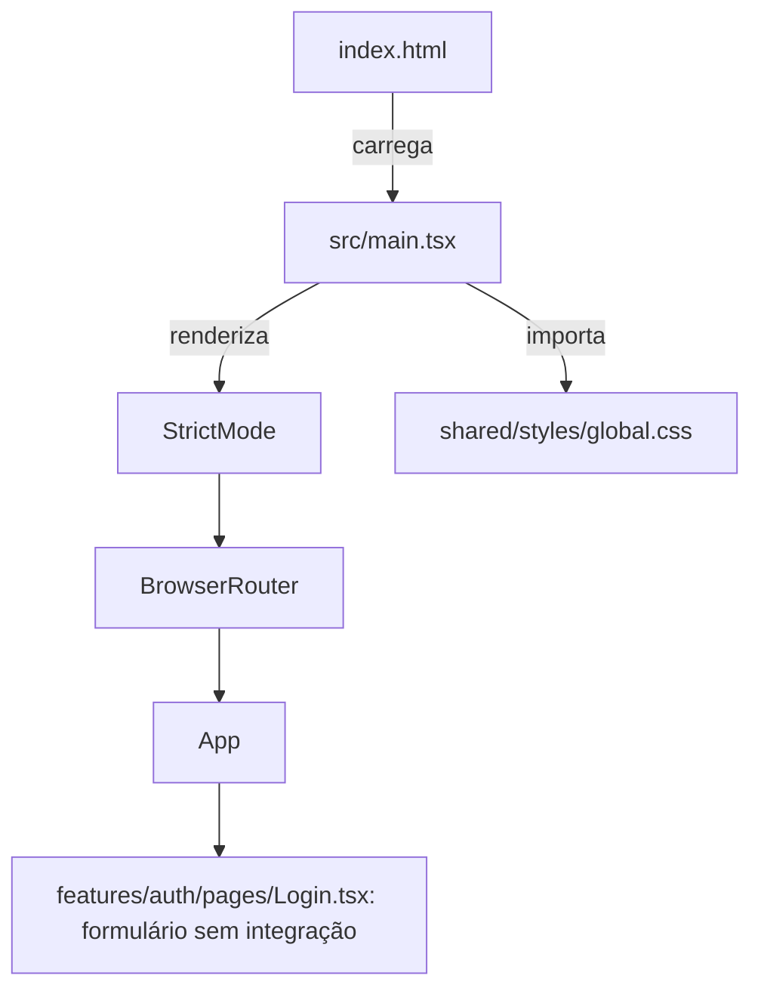
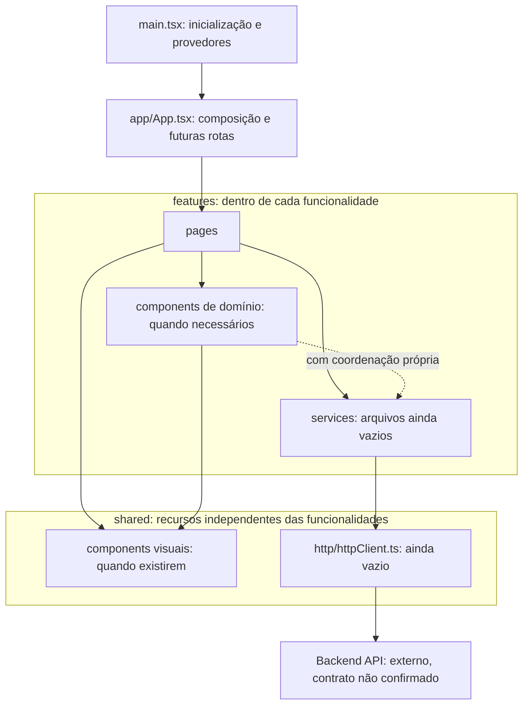

# Registros de decisões arquiteturais do HidroControl

Data de registro: **2026-10-15**. A análise original dos ADRs 0001–0003 partiu do commit `86e54da71a6706e0e38647f93a6feb5e5a81b8a0`. A estrutura da árvore de trabalho foi posteriormente reorganizada conforme o [ADR 0004](0004-organizacao-do-codigo-por-funcionalidade.md). Este índice usa os caminhos atuais; os registros anteriores identificam separadamente suas evidências históricas.

## Como interpretar os registros

| Categoria | Significado nesta documentação |
| --- | --- |
| Implementação atual verificada | Constatação obtida pela leitura dos arquivos e imports, com caminhos citados. Não significa validação da aplicação em execução. |
| Decisão documentada e aceita | Exigiria um registro de aceite. Na análise inicial, não foram encontrados ADRs anteriores nem confirmação de aceite arquitetural no material e no histórico local consultados. |
| Proposta de alteração | Orientação apresentada nestes ADRs, sempre com status **Proposto**, mesmo quando preserva uma organização já encontrada no código. |
| Informação não confirmada | Requisito, contrato, comportamento externo ou justificativa histórica sem evidência disponível. Não deve ser tratado como implementado. |

As alternativas e seus motivos de descarte são resultados desta análise, não relatos das escolhas originais dos autores. A aceitação das propostas depende dos responsáveis pelo projeto e deve ser registrada posteriormente, preservando o histórico. O ADR 0004 revisa o agrupamento de arquivos considerado no ADR 0002, preservando as responsabilidades e o histórico dos registros anteriores.

## Índice

| Número | Título | Status | Documento |
| --- | --- | --- | --- |
| 0001 | Inicialização, composição e roteamento | Proposto | [ADR 0001](0001-inicializacao-composicao-e-roteamento.md) |
| 0002 | Responsabilidades da interface e acesso a serviços | Proposto | [ADR 0002](0002-responsabilidades-da-interface-e-acesso-a-servicos.md) |
| 0003 | Separação entre serviços, HTTP e backend | Proposto | [ADR 0003](0003-separacao-entre-servicos-http-e-backend.md) |
| 0004 | Organização do código por funcionalidade | Proposto | [ADR 0004](0004-organizacao-do-codigo-por-funcionalidade.md) |

## Fonte e limites da análise

O [README do projeto](../../README.md) apresenta um frontend de aprendizado do SENAI para monitoramento de uma usina hidrelétrica. Foram inspecionados a entrada HTML, todo o código em `src/`, configurações, manifesto de dependências e histórico Git disponível. Na análise inicial, não foram encontrados `AGENTS.md`, ADRs preexistentes ou outra documentação arquitetural textual; `docs/README.md` estava vazio antes da entrega documental original. O ADR 0004 registra a reorganização posterior, solicitada explicitamente por funcionalidade e com preservação do esqueleto.

O diagrama original, inspecionado na etapa de análise, tem o título **Diagrama de componentes (UML)** e o caminho histórico `diagramas/Diagrama de componentes UML.png`. A imagem e `diagramas/md` já estavam removidos localmente ao iniciar a escrita destes documentos. Essas remoções foram preservadas. Por isso não há um link relativo para a imagem ausente.

A referência verificável do diagrama é o objeto Git `86e54da71a6706e0e38647f93a6feb5e5a81b8a0:diagramas/Diagrama de componentes UML.png`, cujo blob é `c41f3d99c7700ff1ec9f99ec2ec5c0f995200699`. Para consultar uma cópia fora da árvore do projeto, a partir da raiz do repositório:

```sh
git show '86e54da71a6706e0e38647f93a6feb5e5a81b8a0:diagramas/Diagrama de componentes UML.png' > /tmp/hidrocontrol-diagrama-componentes.png
```

O diagrama é uma referência de intenção. Seus nomes de interfaces não comprovam contratos definidos em TypeScript ou no backend. A menção a um cliente anterior, “antigo api.js”, não foi corroborada pelos arquivos nem pelo histórico local disponível.

Na etapa documental original não foram executados a aplicação ou testes de integração, nem acessado um backend. As verificações da reorganização estão registradas no ADR 0004. A ausência de implementação neste repositório não demonstra ausência de sistemas externos; nenhum contrato de backend foi validado.

## Dependências do diagrama e implementação atual

| Relação no diagrama | Evidência atual | Encaminhamento proposto |
| --- | --- | --- |
| App utiliza Pages | **Verificada:** [App.tsx](../../src/app/App.tsx) importa e renderiza `Login`. | Preservar a composição e localizar futuras declarações de rotas em `App` - ADR 0001. |
| Pages utiliza Components | **Não implementada:** [Login.tsx](../../src/features/auth/pages/Login.tsx) usa elementos HTML diretamente; [Sidebar.tsx](../../src/app/components/Sidebar.tsx) está vazio. | Extrair componentes quando houver responsabilidade ou reutilização concreta - ADR 0002. |
| Pages utiliza Services | **Não implementada:** `Login` não importa nem chama serviços. | Permitir que a página coordene operações por serviços - ADRs 0002 e 0003. |
| Components utiliza Services | **Não implementada:** `Sidebar` não contém código e não existem outros componentes nesse diretório. | Permitir acesso em componentes de domínio com coordenação própria, sem exigir isso de componentes visuais genéricos - ADR 0002. |
| Services utiliza HttpClient | **Não implementada:** [authService.ts](../../src/features/auth/services/authService.ts), [turbinaService.ts](../../src/features/turbinas/services/turbinaService.ts), [telemetriaService.ts](../../src/features/telemetria/services/telemetriaService.ts) e [httpClient.ts](../../src/shared/http/httpClient.ts) têm zero bytes. | Separar operações da aplicação e transporte - ADR 0003. |
| HttpClient utiliza Backend API | **Não implementada:** cliente vazio; nenhuma chamada de API, URL de backend ou contrato de integração foi encontrada no código. | Implementar a fronteira somente com contrato confirmado - ADR 0003. |

Assim, apenas **App → Pages** está materializada entre essas seis relações. O diagrama também inclui Dashboard, Turbinas e Alertas como páginas, mas somente Login existe. Há três arquivos de serviços vazios, nenhum serviço de alertas e nenhuma implementação de telemetria.

## Implementação atual verificada

Este diagrama representa carregamento e composição React observados no código, não uma cadeia de chamadas de API. Os arquivos vazios não participam desse fluxo.



O `BrowserRouter` fornece o contexto de navegação, mas não há declarações de rotas. Os controles de login, recuperação de senha e permanência de sessão não comprovam autenticação funcional. O [ADR 0003](0003-separacao-entre-servicos-http-e-backend.md) distingue a ausência de chamadas de API da submissão nativa possível pelo formulário HTML.

## Arquitetura proposta

As setas abaixo representam dependências permitidas pela proposta, não funcionalidades já entregues nem obrigação de criar todos os módulos imediatamente. Hooks podem concentrar coordenação quando necessário; não são uma camada obrigatória adicional. O agrupamento físico por funcionalidade já foi aplicado conforme o ADR 0004; as dependências de serviços e transporte continuam propostas. As features não importam umas às outras; a composição entre elas fica em `app`, e `shared` não importa features ou `app`.



A expressão do UML “Services: único ponto de contato com o backend” é interpretada nesta proposta como a interface de operações oferecida à aplicação. A comunicação HTTP efetiva fica no `HttpClient`. No registro original, ambos os tipos de arquivo estavam em `src/app/service/`. Após o ADR 0004, os serviços ficam em suas funcionalidades e o cliente em `src/shared/http/`; todos continuam vazios.

Os contratos `IPages` e `IUiComponents` são discutidos nos ADRs 0001 e 0002; `IAuthService`, `ITurbinaService`, `IAlertaService`, `ITelemetriaService`, `IHttpClient` e `IBackendApi`, no ADR 0003. Nenhum desses nomes exige, por si só, uma declaração `interface` em TypeScript.

## Pendências de validação

- **Aceite arquitetural:** confirmar com os responsáveis pelo projeto os quatro registros, todos mantidos como Proposto. O diagrama não contém evidência suficiente de aprovação formal.
- **Backend:** confirmar existência e disponibilidade da API, operações, endereços, formatos, erros e autorização. A indicação “API REST / SCADA” é intenção do diagrama, não contrato verificado.
- **Autenticação:** definir o fluxo real, a sessão, a persistência eventualmente necessária, a recuperação de acesso e os critérios de proteção de telas. A interface atual não fornece essas respostas.
- **Operação:** confirmar telas, navegação e necessidades de turbinas, alertas e telemetria. Texto sobre tempo real no login não especifica frequência, protocolo ou atualização automática.
- **Histórico:** esclarecer, se houver material externo, a referência a `api.js` e decisões anteriores não presentes no histórico consultado.

Essas pendências limitam futuras implementações, mas não impedem documentar os fatos observados. Esta entrega não define endpoints, estruturas de payload, tecnologia de sessão, banco de dados ou mecanismo de atualização da telemetria.

## Critérios de qualidade documental

- Links locais e âncoras devem resolver; caminhos de evidências devem existir. A imagem ausente deve continuar identificada como referência histórica verificável no Git.
- Índice e ADRs devem concordar quanto a número, título, status e data.
- As seis relações do UML devem permanecer classificadas de acordo com o código; arquivos vazios não podem ser descritos como serviços funcionais.
- Critérios futuros dos ADRs são condições para implementar e avaliar as propostas, não testes já aprovados.
- A entrega documental original preservou o código. A reorganização do ADR 0004 deve preservar comportamento, conteúdo dos arquivos movidos, dependências e mudanças locais anteriores.
